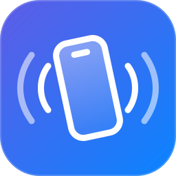
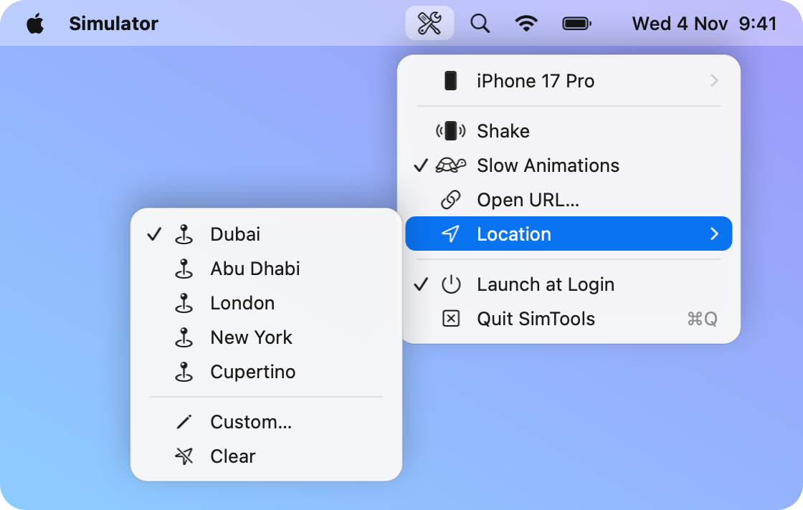
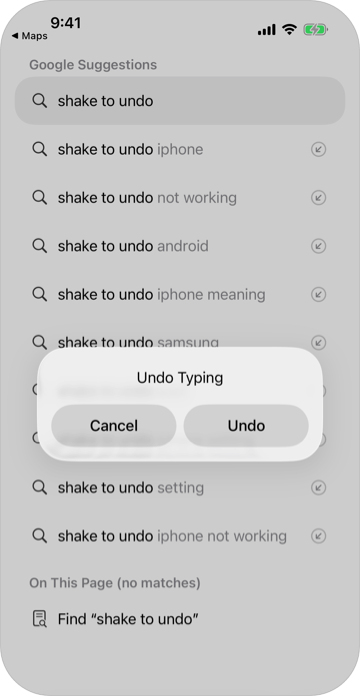
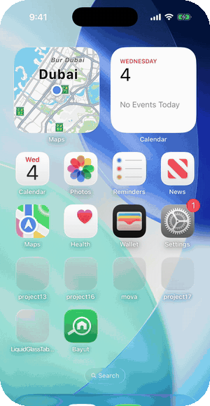
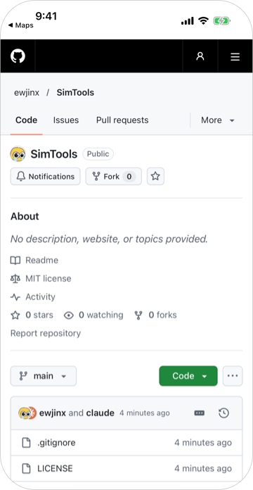
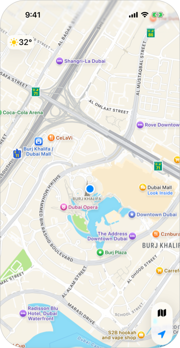

<div align="center">



# SimTools

**The iOS Simulator controls Xcode no longer shows, one click away in your menu bar.**

[](https://github.com/ewjinx/SimTools/releases/latest)
[](#install)
[](main.swift)
[](#install)
[](LICENSE)
[](https://github.com/ewjinx/SimTools/stargazers)

[Features](#features) · [Install](#install) · [How it works](#how-it-works)

<br>

<picture>
  <source media="(prefers-color-scheme: dark)" srcset="assets/menu-dark.png">
  
</picture>

</div>

<br>

Newer Xcode versions dropped **Shake** and **Slow Animations** from the Simulator UI. SimTools brings them back, along with a few other everyday tools, in a native menu bar app smaller than this README.

## Features

<table>
  <tr>
    <td align="center" width="25%"></td>
    <td align="center" width="25%"></td>
    <td align="center" width="25%"></td>
    <td align="center" width="25%"></td>
  </tr>
  <tr>
    <td align="center"><b>Shake</b><br><sub>Triggers <code>motionEnded</code>, shake to undo, debug menus</sub></td>
    <td align="center"><b>Slow Animations</b><br><sub>UIKit slow motion, with live on/off state</sub></td>
    <td align="center"><b>Open URL</b><br><sub>Deep links and web URLs, prefilled from the clipboard</sub></td>
    <td align="center"><b>Location</b><br><sub>Preset cities, custom coordinates or clear</sub></td>
  </tr>
</table>

**Also:**
- **Simulator picker:** choose which booted simulator every action targets.
- **Launch at Login:** SimTools starts with your Mac.

## Install

### Download

Grab the **.dmg** from the [latest release](https://github.com/ewjinx/SimTools/releases/latest), open it and drag SimTools into Applications.

> [!IMPORTANT]
> SimTools isn't notarized, so macOS blocks the first launch. Open it once, then go to **System Settings → Privacy & Security** and click **Open Anyway**. Or run:
> ```bash
> xattr -dr com.apple.quarantine /Applications/SimTools.app
> ```

### Build from source

```bash
git clone https://github.com/ewjinx/SimTools.git
cd SimTools
./build.sh
```

`build.sh` compiles a universal (Apple silicon + Intel) app, installs it to `~/Applications` and launches it. It needs no Xcode project, no packages and no signing account. Run `./build.sh dmg` to package a release DMG instead.

> [!NOTE]
> Requires **macOS 13+** and **Xcode** (for `swiftc` and `simctl`). Boot a simulator, then click the wrench and screwdriver icon in the menu bar.

## How it works

SimTools is a thin wrapper around `xcrun simctl`. Each action runs a single command:

| Action | `xcrun simctl …` |
|---|---|
| Shake | `spawn <udid> notifyutil -p com.apple.UIKit.SimulatorShake` |
| Slow Animations | `spawn <udid> notifyutil -s com.apple.UIKit.SimulatorSlowMotionAnimationState 1 -p …` |
| Open URL | `openurl <udid> myapp://path` |
| Location | `location <udid> set 25.1972,55.2744` |
| Simulator list | `list devices booted -j` |

## License

[MIT](LICENSE). Contributions welcome.

<div align="center">
<sub>Built for iOS developers who miss <kbd>⌘</kbd><kbd>⌃</kbd><kbd>Z</kbd>.</sub>
</div>
